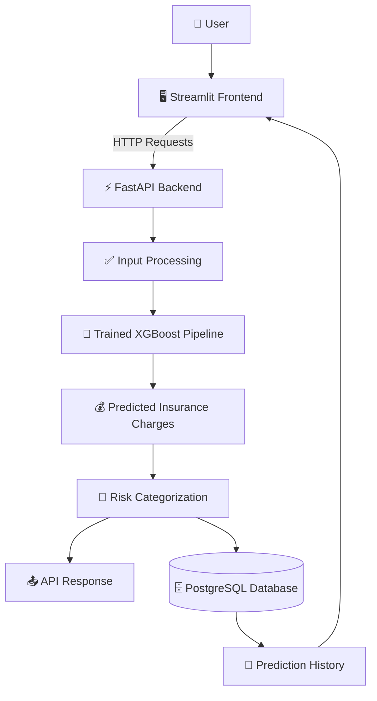

# 🛡️ Insurance Risk & Premium Decision Support System

### An End-to-End Machine Learning Application for Insurance Charge Prediction

<p align="center">
  A machine learning system that predicts insurance charges and categorizes risk using customer demographic and lifestyle attributes, with a deployed API, interactive dashboard, and persistent prediction history.
</p>

<p align="center">
  
  
  
  
  
  
  
  
</p>

<p align="center">
  <a href="https://insurance-risk-backend-pypl.onrender.com/docs">🚀 Live API Documentation</a>
  &nbsp; • &nbsp;
  <a href="https://github.com/ArpitaTrip1402/Insurance-Risk-System">💻 Source Code</a>
  &nbsp; • &nbsp;
  <a href="YOUR_RENDER_FRONTEND_URL">🌐 Live Application</a>
</p>

---

## 📌 Table of Contents

- [Overview](#-overview)
- [Live Demo](#-live-demo)
- [Key Features](#-key-features)
- [Technology Stack](#-technology-stack)
- [System Architecture](#-system-architecture)
- [Machine Learning Workflow](#-machine-learning-workflow)
- [Model Performance](#-model-performance)
- [API Endpoints](#-api-endpoints)
- [Project Structure](#-project-structure)
- [Local Setup](#-local-setup)
- [Deployment](#-deployment)
- [Future Improvements](#-future-improvements)
- [Disclaimer](#️-disclaimer)

## 🎯 Overview

Insurance charges vary according to factors such as age, BMI, smoking habits, and other customer characteristics. This project uses supervised machine learning to estimate insurance charges and assign a risk category based on the predicted premium.

The application brings together data science, machine learning, backend development, database integration, and cloud deployment in a single working system.

### 🌟 Why This Project?

- 📊 **Data-driven analysis:** Explore customer attributes and their relationship with insurance charges.
- 🧠 **Machine learning:** Compare regression algorithms and tune model hyperparameters.
- ⚡ **Real-time inference:** Generate predictions through a FastAPI backend.
- 📈 **Risk categorization:** Map predicted charges to the application's risk categories.
- 🗄️ **Persistent storage:** Save and retrieve prediction history using PostgreSQL.
- 🌐 **Cloud deployment:** Access the application through a deployed Streamlit frontend and API.

## 🚀 Live Demo

| Component | Link |
|---|---|
| 🌐 Streamlit Application | [Open Live App](YOUR_RENDER_FRONTEND_URL) |
| ⚡ FastAPI Backend | [Open API](https://insurance-risk-backend-pypl.onrender.com) |
| 📚 Interactive API Docs | [Swagger UI](https://insurance-risk-backend-pypl.onrender.com/docs) |
| 💻 GitHub Repository | [View Source Code](https://github.com/ArpitaTrip1402/Insurance-Risk-System) |

> **Note:** The frontend link is a placeholder. Replace it with your actual deployed frontend URL.

## ✨ Key Features

| Feature | Description |
|---|---|
| 💰 Premium Prediction | Estimates insurance charges from customer inputs. |
| 🎯 Risk Categorization | Assigns a risk category using the predicted charge. |
| 📊 Model Comparison | Evaluates multiple regression algorithms using standard metrics. |
| 🔍 Prediction Explanation | Provides an explanation through the implemented API endpoint. |
| 🗃️ Prediction History | Stores and retrieves previous predictions from PostgreSQL. |
| 🖥️ Interactive Dashboard | Provides a user-friendly Streamlit interface. |
| 🔌 REST API | Exposes prediction functionality through FastAPI. |
| 🐳 Containerization | Packages application components with Docker. |
| ☁️ Cloud Deployment | Deploys the frontend and backend on Render. |

## 🧰 Technology Stack

<p align="center">
  
</p>

| Category | Technologies |
|---|---|
| 🐍 Programming | Python |
| 🧹 Data Processing | Pandas, NumPy |
| 📊 Data Visualization | Matplotlib, Seaborn |
| 🤖 Machine Learning | Scikit-learn, XGBoost |
| ⚙️ Preprocessing | StandardScaler, OneHotEncoder, ColumnTransformer |
| 🚀 Backend | FastAPI, Pydantic |
| 🎨 Frontend | Streamlit |
| 🗄️ Database | PostgreSQL, Neon |
| 📦 Model Persistence | Pickle / Joblib |
| 🐳 Containerization | Docker |
| ☁️ Deployment | Render |
| 🔧 Version Control | Git, GitHub |
| 🧪 API Testing | Swagger UI |

## 🏗️ System Architecture



### 🔄 Prediction Flow

1. The user enters customer details in the Streamlit dashboard.
2. The frontend sends the input to the FastAPI backend.
3. The backend preprocesses the input using the trained pipeline.
4. The model predicts the insurance charges.
5. The application assigns a risk category based on its configured logic.
6. The prediction is returned to the user and saved in PostgreSQL.
7. The history page retrieves previously saved predictions.

## 🧠 Machine Learning Workflow

The project follows a structured machine learning pipeline:

**1. Data Collection and Exploration**
- Load and inspect the insurance dataset.
- Examine data types, missing values, and statistical distributions.
- Analyze relationships between customer attributes and insurance charges.

**2. Exploratory Data Analysis (EDA)**
- Study the distribution of insurance charges.
- Investigate the effects of smoking, age, and BMI.
- Identify skewness and potential outliers.

**3. Data Preprocessing**
- Scale numerical features using `StandardScaler`.
- Encode categorical features using `OneHotEncoder`.
- Combine transformations using `ColumnTransformer` and a model pipeline.

**4. Model Training and Comparison**

The following regression models were evaluated:

- Linear Regression
- Random Forest Regressor
- Gradient Boosting Regressor
- XGBoost Regressor

**5. Hyperparameter Tuning**
- Apply grid search with cross-validation.
- Tune parameters such as learning rate, tree depth, and number of estimators.

**6. Evaluation and Deployment**
- Compare models using MAE, RMSE, and R².
- Persist the selected trained pipeline.
- Integrate inference into FastAPI and connect it to the deployed dashboard.

## 📈 Model Performance

The following results are from the model development experiments on the test dataset.

| Model | MAE ↓ | RMSE ↓ | R² ↑ |
|---|---:|---:|---:|
| Linear Regression | 4,177.05 | 5,956.34 | 0.8069 |
| Random Forest | 2,555.16 | 4,639.46 | 0.8829 |
| Gradient Boosting | 2,514.88 | 4,247.10 | 0.9018 |
| XGBoost | 2,578.93 | 4,360.22 | 0.8965 |
| 🏆 **Tuned XGBoost** | **2,462.77** | **4,225.43** | **0.9028** |

The tuned XGBoost model achieved the strongest reported test-set results among these experiments.

### 🏆 Selected Model Configuration

```python
{
    "n_estimators": 100,
    "learning_rate": 0.05,
    "max_depth": 3
}
```

### 📐 Evaluation Metrics

- **MAE (Mean Absolute Error):** Measures the average absolute prediction error.
- **RMSE (Root Mean Squared Error):** Penalizes larger prediction errors more heavily.
- **R² (Coefficient of Determination):** Measures how much of the target variance is explained by the model on the evaluation data.

Lower MAE and RMSE values indicate smaller prediction errors, while higher R² indicates a better fit to the evaluation data.

## 🔌 API Endpoints

**Base URL:** `https://insurance-risk-backend-pypl.onrender.com`

| Method | Endpoint | Purpose |
|---|---|---|
| `POST` | `/predict` | Generate an insurance charge prediction and risk category. |
| `GET` | `/explain` | Access the implemented prediction explanation functionality. |
| `GET` | `/history` | Retrieve stored prediction history. |
| `GET` | `/docs` | Open interactive Swagger documentation. |

Check `/docs` for the exact request schemas and response formats supported by the deployed API.

### 📨 Example Prediction Request

**Endpoint:** `POST /predict`

```json
{
  "age": 30,
  "sex": "male",
  "bmi": 25.5,
  "children": 1,
  "smoker": "no",
  "region": "southwest"
}
```

The API returns a prediction and risk category according to the application's response schema.

## 📂 Project Structure

```text
Insurance-Risk-System/
│
├── 📁 Data/
├── 📁 models/
│   └── insurance_model.pkl
├── 📁 notebooks/
├── 📁 src/
│   └── api.py
├── 📁 frontend/
│   └── app.py
├── 📁 tests/
├── 📁 docker/
├── 🐳 Dockerfile.backend
├── 🐳 Dockerfile.frontend
├── 🐳 docker-compose.yml
├── 📄 README.md
└── 📄 .gitignore
```

> This is a representative structure. Adjust the tree to match the actual files and folders in the repository.

## 💻 Local Setup

### 1️⃣ Clone the Repository

```bash
git clone https://github.com/ArpitaTrip1402/Insurance-Risk-System.git
cd Insurance-Risk-System
```

### 2️⃣ Create a Virtual Environment

```bash
python -m venv .venv
```

Activate it in Windows PowerShell:

```powershell
.\.venv\Scripts\Activate.ps1
```

### 3️⃣ Install Backend Dependencies

```bash
pip install -r docker/backend-requirements.txt
```

Install the frontend dependencies too if your repository maintains a separate requirements file.

### 4️⃣ Configure Environment Variables

Configure your local PostgreSQL connection using the environment variables expected by the backend:

```text
DB_HOST=localhost
DB_PORT=5432
DB_NAME=insurance_risk_db
DB_USER=postgres
DB_PASSWORD=your_local_database_password
```

Use your own local database settings. Keep actual credentials in an untracked `.env` file or environment variables, never in committed source code.

### 5️⃣ Start the Backend

```bash
uvicorn src.api:app --reload
```

Open the API documentation at:

`http://127.0.0.1:8000/docs`

### 6️⃣ Start the Frontend

In another terminal, activate the environment and set the backend URL:

```powershell
$env:API_URL="http://127.0.0.1:8000"
```

Run the Streamlit application:

```bash
streamlit run frontend/app.py
```

Open the dashboard at:

`http://localhost:8501`

> Ensure PostgreSQL is running, the required database table exists, and the trained model artifact is available before testing locally.

## 🐳 Deployment

The application is deployed using Render and Neon PostgreSQL.

- **Frontend:** Streamlit web service.
- **Backend:** FastAPI web service packaged using `Dockerfile.backend`.
- **Database:** Neon PostgreSQL for persistent prediction history.
- **Containerization:** Dockerfiles separate the frontend and backend environments.
- **Configuration:** Environment variables connect the deployed services without hardcoding credentials.

The frontend uses `API_URL` to communicate with the backend. The backend uses database environment variables to connect to PostgreSQL.

## 🔐 Security Considerations

- Keep credentials and secret keys out of GitHub.
- Configure production settings through environment variables.
- Validate user inputs before running inference.
- Handle database and API errors without exposing sensitive internal details.
- Use appropriate database permissions and rotate any credentials that become exposed.

## 🔮 Future Improvements

- [ ] Add automated unit and integration tests.
- [ ] Strengthen request validation and error handling.
- [ ] Add model explainability with feature attribution.
- [ ] Add monitoring for prediction quality and application health.
- [ ] Introduce CI/CD checks for safer deployments.
- [ ] Track model versions and evaluate retraining strategies.

## ⚠️ Disclaimer

This project is intended for educational and decision-support purposes. Predicted insurance charges and risk categories are estimates, not official insurance quotes, medical assessments, or underwriting decisions. Actual premiums depend on insurer-specific pricing rules and additional factors that may not be represented in the dataset.

## 👩‍💻 Author

**Arpita Tripathi**

🎓 B.Tech — Information Technology

- 🐙 [GitHub Profile](https://github.com/ArpitaTrip1402)
- 📁 [Project Repository](https://github.com/ArpitaTrip1402/Insurance-Risk-System)

---

<p align="center">
  ⭐ If you find this project interesting, consider starring the repository!
</p>
